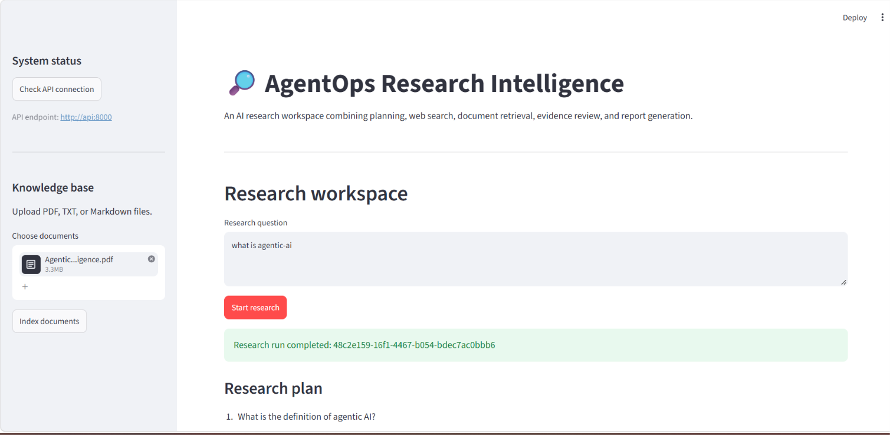
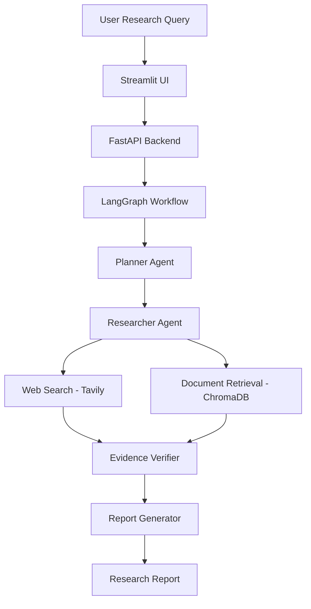

# AgentOps Research Intelligence

An AI-powered research application combining LangGraph workflows, LLM-based planning, web search, document RAG, evidence verification, and automated report generation.

## Dashboard Preview



## Features

- LLM-powered research planning
- Web search using Tavily
- PDF, TXT, and Markdown document ingestion
- Semantic document retrieval using ChromaDB
- Evidence review and automated report generation
- Multi-step orchestration using LangGraph
- FastAPI backend
- Interactive Streamlit frontend
- Pytest API tests

## Architecture

The application follows a multi-agent research workflow:



### Workflow Components

1. **Planner:** Breaks the research question into tasks.
2. **Researcher:** Collects information from web search and documents.
3. **Evidence Verifier:** Reviews collected evidence.
4. **Report Generator:** Produces the final research report.

The researcher combines web search results with relevant passages retrieved from the document knowledge base.

## Technology Stack

- **Language:** Python
- **LLM:** OpenAI API
- **Agent Orchestration:** LangGraph
- **Backend:** FastAPI
- **Frontend:** Streamlit
- **Vector Database:** ChromaDB
- **Web Search:** Tavily
- **Testing:** Pytest

## Requirements

- Python 3.11 or 3.12
- OpenAI API key
- Tavily API key for live web search

## Installation and Setup

Clone the repository:

```bash
git clone https://github.com/Ankit01032003/agentops-research-intelligence.git
cd agentops-research-intelligence
```

Create a virtual environment:

```bash
python -m venv .venv
```

Install dependencies:

```bash
python -m pip install -r requirements.txt
```

Create a `.env` file using `.env.example` and configure the required API keys.

## Run with Docker Compose

1. Copy `.env.example` to `.env`.
2. Add your OpenAI API key. Add a Tavily key to enable live web search.
3. Start both services:

```bash
docker compose up --build -d
```

- Streamlit dashboard: http://localhost:8501
- FastAPI docs: http://localhost:8000/docs
- Health check: http://localhost:8000/health

View logs:

```bash
docker compose logs -f
```

Stop services:

```bash
docker compose down
```

Research history and ChromaDB data persist in the Docker volume `agentops_data`. To remove stored data as well, run `docker compose down -v`.

## Run the Backend

```bash
uvicorn app.main:app --reload
```

API documentation:

http://127.0.0.1:8000/docs

## Run the Frontend

Open a second terminal and run:

```bash
streamlit run frontend/streamlit_app.py
```

Open the local URL displayed in your terminal.

## Run Tests

```bash
pytest -q
```

## Current Limitations

- The workflow currently follows a predefined LangGraph structure.
- LLM-based evidence review does not guarantee factual accuracy.
- Document retrieval currently uses basic semantic search.
- The application is intended for local development rather than unrestricted public access.
- Authentication, advanced evaluation, and production deployment can be further improved.

## Security

- Store API keys in `.env`.
- Never commit credentials or secrets to GitHub.
- Avoid exposing unrestricted tools to LLM agents.
- Validate external inputs before processing them.

## Author

**Ankit Sharma**

GitHub: [Ankit01032003](https://github.com/Ankit01032003)